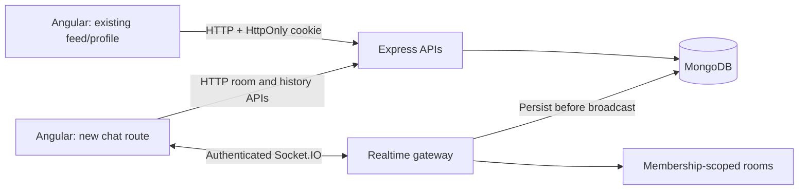

# Architecture and interview notes

## Request and event paths

Authentication reuses one account identity across both application areas. Session tokens are cryptographically random; MongoDB stores only their SHA-256 digest with an expiry and TTL index. Expiry is also checked explicitly rather than relying on asynchronous TTL deletion. Passwords use asynchronous scrypt with random salts. Google OAuth is optional; state is checked against an HttpOnly cookie.

The socket handshake derives identity from the session cookie. Clients cannot choose their sender identity. Each socket operation revalidates the session and database room membership. Logout and password changes revoke the corresponding sockets. Removal pulls membership and invitation, removes active sockets from the room, and rejects subsequent history and send requests.

## Models and indexes

- Existing `User`, `Profile`, `Article`, `Following` remain the social application foundation.
- `Session`: unique `tokenHash`, indexed username, TTL `expiresAt`.
- `Room`: owner, members, invited users, visibility, capacity, optional source-post ID. Index `(members, createdAt)`.
- `Message`: room, sender, text, client-generated ID, optional shared-post ID, timestamps. Index `(room, _id descending)` supports history; unique `(room, sender, clientId)` prevents duplicate persisted sends.

Room join uses one conditional update with an atomic capacity predicate and `$addToSet`, avoiding a read-then-write over-capacity race.

## Message lifecycle

1. Client assigns a UUID; an uncertain retry retains that UUID and draft.
2. Server validates session, membership, input bounds, and per-user throttling.
3. Server writes the message before broadcasting it. A duplicate-key retry returns the existing message.
4. The client merges broadcasts and acknowledgements by database message ID.
5. On reconnect it rejoins and reloads the newest history page; older pages use an exclusive ObjectId cursor (50 messages per page).

This yields durable storage and idempotent retry behavior, not exactly-once event delivery. Socket.IO transport order is distinct from global database ordering. The history cursor uses ObjectId ordering and is sufficient for this single-process demo; it is not a globally monotonic distributed sequence.

## Tradeoffs to explain honestly

- **Extend rather than rewrite:** Angular + Express + MongoDB preserves completed HW7 work and adds realtime behavior at a clear boundary. The Java project contributes product ideas rather than a second account system or a second server.
- **Membership arrays:** simple, bounded at 50 members and atomically checked. Larger rooms should separate memberships into an indexed collection.
- **Single process:** presence and throttling live in memory; sessions and messages live in MongoDB. Scaling sockets needs a shared adapter, shared throttling, load-balancer connection strategy, and consistent fanout behavior.
- **Write then broadcast:** avoids showing a message that was never stored; a crash after persistence but before broadcast can delay delivery until history recovery. A transactional outbox is a future reliability improvement.
- **Pagination:** recent-history requests stay bounded. The room directory currently limits results to 100 rather than implementing full search/pagination.
- **Feed scope:** numeric article/comment IDs now use atomic counters, and concurrent-write regression tests pass. Feed results are bounded at 500 and UI pagination remains local. Embedded comments remain a scaling limitation; cursor feed pagination and a separate comment collection would be future work.

## What was fixed at the integration boundary

Registration now issues the cookie expected by the existing Angular registration flow. Comments use the actual server-returned persisted result. The feed no longer silently discards all but ten fetched posts before its local pagination. The unsupported multipart image picker and fabricated feed images were removed. Feed posts link to the new chat route with a post context. Hardcoded original credentials are absent from this copy.

## Deployment and follow-up verification

The browser now uses same-origin `/api` requests; Express retains legacy HW7 endpoints for compatibility. Angular dev mode proxies `/api` and `/socket.io`; the production container serves the SPA and API from one process. Route guards verify the server session instead of trusting cached browser identity. OAuth state is one-time, hashed in MongoDB with expiry, compared to an HttpOnly cookie, and consumed before token exchange. Each app instance uses an isolated Passport instance.

The regression pass also fixed server logout invocation, actual password changes, atomic profile validation, raster-avatar limits, private contact access, concurrent numeric IDs, fabricated comment emails, and random third-party avatars.
